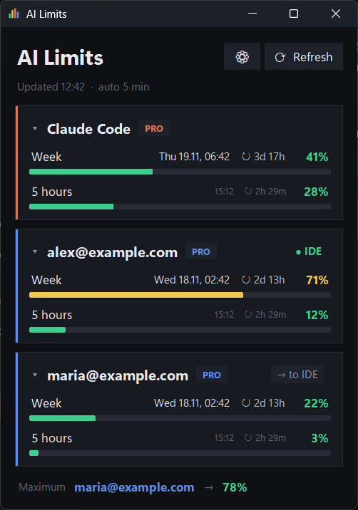
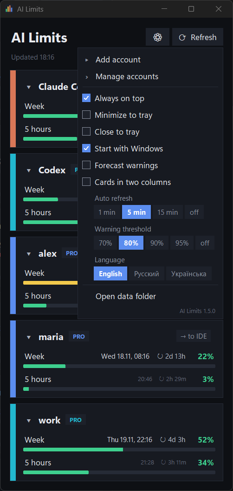
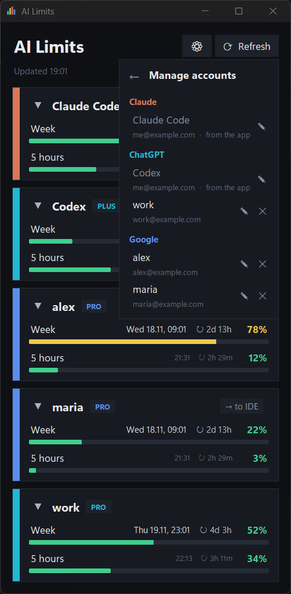
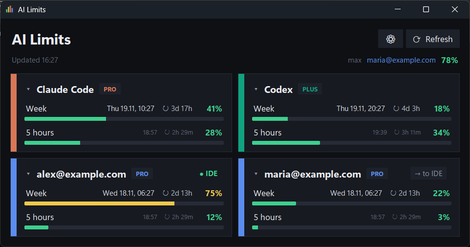
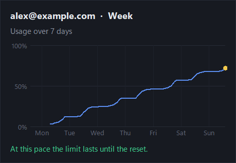
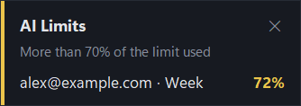

# AI Limits

**English** | [Русский](README.ru.md)

A small Windows 11 desktop app that shows how much of your **Claude Code** (Claude subscription), **Codex**
(ChatGPT subscription) and **Google Antigravity** (Gemini models) usage limits you have spent — for several
accounts of each service at once. It picks up the accounts your apps are already signed in to by itself and can
switch the account the Antigravity IDE is signed in to with one click.

> Unofficial project. Not affiliated with Anthropic, OpenAI or Google. The window is available in English, Russian and
> Ukrainian (⚙ → Language); the console version is in Russian.

<p>
  
  
</p>

## Features

**Accounts**
- On the first start every account your apps are already signed in to shows up by itself: one card each for
  **Claude Code**, **Codex** and the **Antigravity** IDE, titled with the app name. A card always follows the
  account its app is signed in to right now.
- ⚙ → **Add account**: Claude, ChatGPT or Google. Claude and ChatGPT accounts sign in through Claude Code
  (`claude auth login`) and Codex (`codex login`) into a separate profile folder of AI Limits, so your own
  Claude Code and Codex sign-ins stay untouched; Google signs in in the browser. If the new account is the one an
  app is signed in to, that app's card simply takes its name.
- Every account has a name of your choice, unique within the app (by default the part of the email before «@»; if
  taken, with the service in front: "Codex alex"). Rename it by double-clicking the name on its card or in
  ⚙ → **Manage accounts**, which lists the accounts by service with the email below the name and can delete them; ↻ signs in to an added account again to refresh its sign-in (only the same account is accepted).

**Limits**
- Weekly and 5-hour limits for Claude Code, Codex (ChatGPT subscription) and each Google account (Gemini), with
  reset time and countdown.
- The app's own sign-ins of Claude Code and Codex are only read (replaced only when you press "→ to Codex" or
  "→ to Claude"); the tokens of the profiles AI Limits signed in itself are kept encrypted and refreshed by AI Limits.
- The limits of a closed Antigravity IDE come from the cloud using the IDE's own saved sign-in.
- Reads the most accurate numbers straight from a running Antigravity IDE; falls back to the cloud API otherwise.
- The account with the most weekly limit left, of any service, is shown at the top right ("max … 100%").
- Usage history (kept for 60 days): click a limit row to see its usage chart and a forecast of how long the limit
  will last at the current pace.

**Antigravity IDE account**
- **"→ to IDE" button**: signs the Antigravity IDE in to another saved account without the Google sign-in page
  (the IDE is restarted; the previous credentials are backed up and restored if the switch fails).
- Works when the IDE is closed too: it starts the IDE (or the `agy` CLI if the IDE is not installed) and skips the
  switch when the IDE is already signed in to that account.

**Codex account**
- **"→ to Codex" button** on added ChatGPT accounts: makes Codex use that account. The Codex app is closed and
  started again; the current Codex sign-in is backed up and kept in AI Limits as an account you can switch back to
  (added automatically if it was not). Codex running in a terminal is not closed — you are asked to close it.

**Claude Code account**
- **"→ to Claude" button** on added Claude accounts: Claude Code starts working as that account. Only its sign-in is
  replaced (the token in `~/.claude/.credentials.json` and the account in `~/.claude.json`; other settings stay);
  Claude is not closed. New Claude Code sessions use the new account, open ones keep the previous one until restarted
  — an open session may even bring the previous sign-in back, then switch again. The previous sign-in is backed up and
  kept in AI Limits as an account you can switch back to.

**Window**
- Cards can be collapsed (a collapsed card shows how much of its weekly limit is left), reordered by dragging the
  colored strip on their left (the other cards slide aside), and laid out in two columns (⚙ → Cards in two columns).
- Auto refresh (1 / 5 / 15 min), always-on-top. Cards update in place without flicker.
- Tray icon with a mini window on hover (same card order), a dark context menu, minimize/close to tray, start with
  Windows. Clicking the icon brings the window to the front, or hides it to the tray if it is already in focus.
- Pop-up warning above the clock when a limit crosses the threshold you chose (70–95 %, or off). Pop-up forecast
  warnings are off by default (⚙ → Forecast warnings).

**Other**
- Console version with plain-text and JSON output.
- Version shown in the settings menu and in the exe properties; unhandled errors are written to a log file.
- Tokens and keys are stored encrypted (Windows DPAPI).
- No third-party packages: Python standard library only (tkinter + ctypes).

<p>
  
</p>
<p>
  
</p>
<p>
  
  
</p>

## Download

A ready-made `AI Limits.exe` is attached to each [release](https://github.com/Biz2k/AI-Limits/releases); Python is
not needed to run it.

- The exe is not code-signed, so Windows SmartScreen may show "Windows protected your PC" on the first start:
  choose **More info → Run anyway**.
- Each release lists the SHA-256 of the exe. To check your download, run in PowerShell
  `Get-FileHash "AI Limits.exe" -Algorithm SHA256` and compare the result.
- The exe contains no keys. When you add a Google account, AI Limits automatically finds the installed
  **Antigravity** IDE, extracts its OAuth client id and secret, and saves them encrypted in
  `%APPDATA%\ai-limits\keys.dat`. If Antigravity is not installed, it uses the saved key from `keys.dat` (or
  the `ANTIGRAVITY_OAUTH_CLIENT_ID` / `ANTIGRAVITY_OAUTH_CLIENT_SECRET` environment variables); if neither the
  app nor a key is found, it shows a pop-up asking you to install the required app (Antigravity, Claude Code,
  or Codex):

  ```
  setx ANTIGRAVITY_OAUTH_CLIENT_ID "<client id>"
  setx ANTIGRAVITY_OAUTH_CLIENT_SECRET "<client secret>"
  ```

  The Claude Code and Codex cards (and added Claude and ChatGPT accounts) work without Google keys.

## Requirements

For running from source:

- Windows 11
- Python 3.13 (the Microsoft Store build works)
- Claude Code installed and signed in (`~/.claude/.credentials.json`) — for the Claude card
- Codex signed in with a ChatGPT account (`~/.codex/auth.json`) — optional, for the Codex card; Codex
  (`codex.exe`) or Claude Code (`claude.exe`) is also needed to add more ChatGPT or Claude accounts
- Antigravity IDE — optional, needed for IDE data and account switching
- PyInstaller 6.x — only if you want to build the exe

## Setup

1. Clone the repository.
2. Run the window:

   ```
   pythonw limits_gui.pyw
   ```

3. OAuth client id and secret of the Antigravity application are **not included** in this repository or in the
   exe. When you add a Google account, AI Limits automatically reads them from your installed Antigravity IDE
   and saves them encrypted in `%APPDATA%\ai-limits\keys.dat`. If Antigravity is not installed on that machine,
   you can enter them manually with `python limits.py keys` (close the window first, start it again afterwards),
   set the `ANTIGRAVITY_OAUTH_CLIENT_ID` and `ANTIGRAVITY_OAUTH_CLIENT_SECRET` environment variables, or, when
   running from source, copy `local_keys.example.py` to `local_keys.py` and fill it in (these values are also
   available in the open-source npm package [`antigravity-usage`](https://www.npmjs.com/package/antigravity-usage)).
4. Add accounts if you need more than the ones your apps are signed in to: ⚙ → "Add account" → Claude,
   ChatGPT or Google.

## Console version

```
python limits.py                  show all limits
python limits.py -w 60            refresh every 60 seconds
python limits.py --json           JSON output
python limits.py --version        show the version
python limits.py add              add a Google account
python limits.py accounts         list saved accounts
python limits.py remove <email>   remove an account
python limits.py switch-ide <email>    sign the Antigravity IDE in to this account
python limits.py switch-ide --browser  the same through the Google sign-in page
python limits.py restore-ide           put back the IDE credentials from the latest backup
python limits.py keys                  enter the Antigravity OAuth client id and secret
```

Claude and ChatGPT accounts added in the window are shown by the console version too (`--json`: `profiles`).

## Building the exe

```
python -m pip install --user pyinstaller
build_exe.cmd
```

The script runs the checks from `tests\` (on made-up data; the app window opens for a few seconds), then builds a
single windowed `AI Limits.exe` and puts it into the parent folder, with its SHA-256 in `AI Limits.exe.sha256`
next to it. The exe contains no keys and no tokens.

To run the checks alone: `python tests\run_tests.py`.

## Where data is stored

Everything lives in `%APPDATA%\ai-limits\`:

| File | Contents |
| --- | --- |
| `accounts.json` | Google refresh tokens of the accounts you added (encrypted) |
| `profiles.json`, `profiles\` | Claude and ChatGPT accounts you added: one folder each, the sign-in in `creds.dat` (encrypted) |
| `keys.dat` | Antigravity OAuth client id and secret (encrypted) |
| `cache.json` | last seen limit values (kept until each limit resets) |
| `gui.json` | window settings, account names |
| `history.csv` | limit values over time, kept for 60 days (no tokens) |
| `ide_backups\` | copies of the IDE credentials taken before each account switch (last 5, encrypted) |
| `ide_switch.log` | account switch log (tokens are masked) |
| `codex_backups\` | copies of the Codex sign-in taken before each "→ to Codex" (last 5, encrypted) |
| `claude_backups\` | copies of the Claude Code sign-in taken before each "→ to Claude" (last 5, encrypted) |
| `app.log` | unhandled errors with the app version (token-like strings are masked) |

Tokens, keys and the credential copies are encrypted with Windows DPAPI: only your Windows account on this
computer can decrypt them, so the folder is useless on another machine or for another user (add the accounts and
keys again there). Programs running under your own account can still decrypt them.

## How IDE account switching works

When you press "→ to IDE", the app gets a fresh access token for the chosen account, backs up the current IDE
credentials, closes the IDE, writes the token into the IDE's entry in Windows Credential Manager
(`gemini:antigravity`) and two files in `%APPDATA%\Antigravity\`, starts the IDE again and checks through the IDE's
local server that the right account is signed in. If the IDE shows another account or no account, the backup is
restored.

If the IDE is closed and its saved sign-in already belongs to the chosen account, the app just starts the IDE.
If the IDE is not installed, the `agy` CLI is started instead (it uses the same Credential Manager entry); there
is no IDE server to check the account against in that case.

This is not an official mechanism. It may stop working after an IDE update, and you use it at your own risk.

## Disclaimer

- The app relies on undocumented endpoints of Anthropic, OpenAI and Google and on the OAuth clients of Claude
  Code, Codex and Antigravity (extra Claude and ChatGPT accounts are signed in by Claude Code and Codex themselves).
  They can change or be blocked at any time, and using them may be against the services' terms.
- To get both Gemini limits for accounts that are not signed in to the IDE, requests to Google identify the app
  as a recent version of the Antigravity IDE.
- It reads and writes credentials of the Antigravity IDE on your machine.
- No warranty of any kind; see the license.

## License

[MIT](LICENSE)
