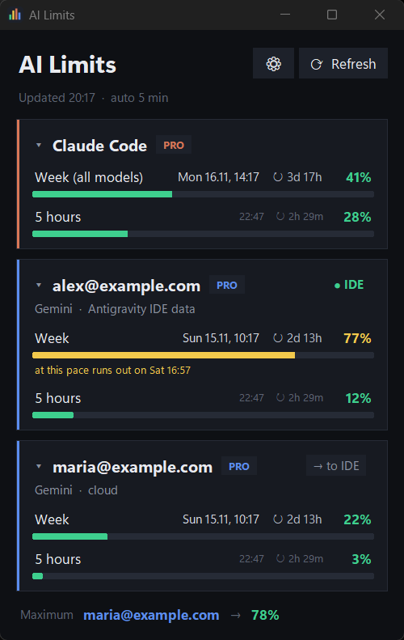
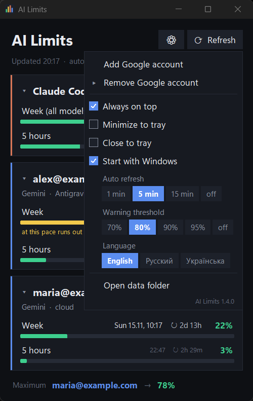
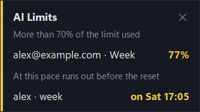

# AI Limits

**English** | [Русский](README.ru.md)

A small Windows 11 desktop app that shows how much of your **Claude Code** (Pro subscription) and
**Google Antigravity** (Gemini models) usage limits you have spent — for several Google accounts at once.
It can also switch the account the Antigravity IDE is signed in to with one click.

> Unofficial project. Not affiliated with Anthropic or Google. The window is available in English, Russian and
> Ukrainian (⚙ → Language); the console version is in Russian.

<p>
  
  
</p>

## Features

- Weekly and 5-hour limits for Claude Code and for each Google account, with reset time and countdown.
- Reads the most accurate numbers straight from a running Antigravity IDE; falls back to the cloud API otherwise.
- **"→ to IDE" button**: signs the Antigravity IDE in to another saved account without the Google sign-in page
  (the IDE is restarted; the previous credentials are backed up and restored if the switch fails).
- Tray icon with a mini window on hover, a dark context menu, minimize/close to tray, start with Windows.
- Pop-up warning above the clock when a limit crosses the threshold you chose (70–95 %, or off).
- Usage history (kept for 60 days) and a forecast: when a limit is going to run out before it resets, the card
  and the tray window say how long it will last; click a limit row to see its usage chart. Pop-up forecast
  warnings are off by default (⚙ → Forecast warnings).
- Auto refresh (1 / 5 / 15 min), always-on-top, collapsible cards. Cards update in place without flicker.
- Console version with plain-text and JSON output.
- Version shown in the settings menu and in the exe properties; unhandled errors are written to a log file.
- Tokens and keys are stored encrypted (Windows DPAPI).
- No third-party packages: Python standard library only (tkinter + ctypes).



## Download

A ready-made `AI Limits.exe` is attached to each [release](https://github.com/Biz2k/AI-Limits/releases); Python is
not needed to run it.

- The exe is not code-signed, so Windows SmartScreen may show "Windows protected your PC" on the first start:
  choose **More info → Run anyway**.
- Each release lists the SHA-256 of the exe. To check your download, run in PowerShell
  `Get-FileHash "AI Limits.exe" -Algorithm SHA256` and compare the result.
- The exe contains no keys. Before adding a Google account, set the OAuth client id and secret of the Antigravity
  application (see [Setup](#setup) for where they come from) as environment variables, then start the app again:

  ```
  setx ANTIGRAVITY_OAUTH_CLIENT_ID "<client id>"
  setx ANTIGRAVITY_OAUTH_CLIENT_SECRET "<client secret>"
  ```

  The Claude Code card works without them.

## Requirements

For running from source:


- Windows 11
- Python 3.13 (the Microsoft Store build works)
- Claude Code installed and signed in (`~/.claude/.credentials.json`) — for the Claude card
- Antigravity IDE — optional, needed for IDE data and account switching
- PyInstaller 6.x — only if you want to build the exe

## Setup

1. Clone the repository.
2. Run the window:

   ```
   pythonw limits_gui.pyw
   ```

3. Enter the OAuth client id and secret of the Antigravity application with `python limits.py keys`
   (close the window first, start it again afterwards). They are **not included** in this repository or in the exe. These are the values
   the Antigravity application itself signs in with; the open-source npm package
   [`antigravity-usage`](https://www.npmjs.com/package/antigravity-usage) contains them in its source code — that is
   where this project took them from. The app keeps them in
   `%APPDATA%\ai-limits\keys.dat`, encrypted for your Windows account. Alternatively, set the
   `ANTIGRAVITY_OAUTH_CLIENT_ID` and `ANTIGRAVITY_OAUTH_CLIENT_SECRET` environment variables, or, when running
   from source, copy `local_keys.example.py` to `local_keys.py` and fill it in.
4. Add a Google account: ⚙ → "Add Google account" (a Google sign-in page opens in your browser).

## Console version

```
python limits.py                  show all limits
python limits.py -w 60            refresh every 60 seconds
python limits.py --json           JSON output
python limits.py --version        show the version
python limits.py add              add a Google account
python limits.py accounts         list saved accounts
python limits.py remove <email>   remove an account
python limits.py switch-ide <email>    sign the Antigravity IDE in to this account
python limits.py switch-ide --browser  the same through the Google sign-in page
python limits.py restore-ide           put back the IDE credentials from the latest backup
python limits.py keys                  enter the Antigravity OAuth client id and secret
```

## Building the exe

```
python -m pip install --user pyinstaller
build_exe.cmd
```

The script runs the checks from `tests\` (on made-up data; the app window opens for a few seconds), then builds a
single windowed `AI Limits.exe` and puts it into the parent folder, with its SHA-256 in `AI Limits.exe.sha256`
next to it. The exe contains no keys and no tokens.

To run the checks alone: `python tests\run_tests.py`.

## Where data is stored

Everything lives in `%APPDATA%\ai-limits\`:

| File | Contents |
| --- | --- |
| `accounts.json` | Google refresh tokens of the accounts you added (encrypted) |
| `keys.dat` | Antigravity OAuth client id and secret (encrypted) |
| `cache.json` | last seen limit values (kept until each limit resets) |
| `gui.json` | window settings |
| `history.csv` | limit values over time, kept for 60 days (no tokens) |
| `ide_backups\` | copies of the IDE credentials taken before each account switch (last 5, encrypted) |
| `ide_switch.log` | account switch log (tokens are masked) |
| `app.log` | unhandled errors with the app version (token-like strings are masked) |

Tokens, keys and the credential copies are encrypted with Windows DPAPI: only your Windows account on this
computer can decrypt them, so the folder is useless on another machine or for another user (add the accounts and
keys again there). Programs running under your own account can still decrypt them.

## How IDE account switching works

When you press "→ to IDE", the app gets a fresh access token for the chosen account, backs up the current IDE
credentials, closes the IDE, writes the token into the IDE's entry in Windows Credential Manager
(`gemini:antigravity`) and two files in `%APPDATA%\Antigravity\`, starts the IDE again and checks through the IDE's
local server that the right account is signed in. If the IDE shows another account or no account, the backup is
restored.

This is not an official mechanism. It may stop working after an IDE update, and you use it at your own risk.

## Disclaimer

- The app relies on undocumented endpoints of Anthropic and Google and on the OAuth clients of Claude Code and
  Antigravity. They can change or be blocked at any time, and using them may be against the services' terms.
- To get both Gemini limits for accounts that are not signed in to the IDE, requests to Google identify the app
  as a recent version of the Antigravity IDE.
- It reads and writes credentials of the Antigravity IDE on your machine.
- No warranty of any kind; see the license.

## License

[MIT](LICENSE)
