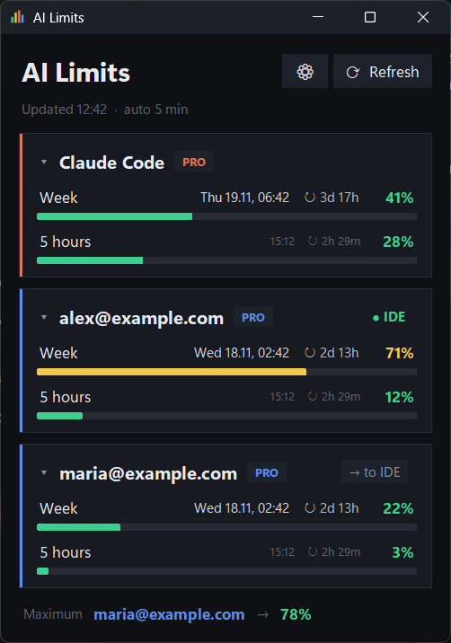
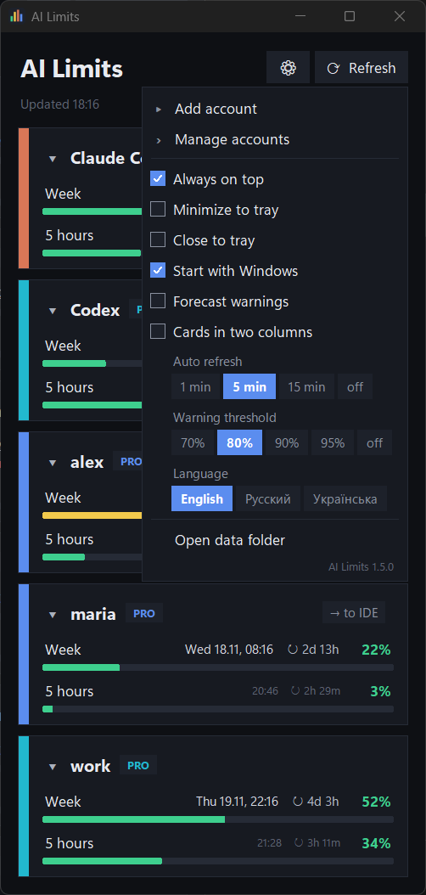
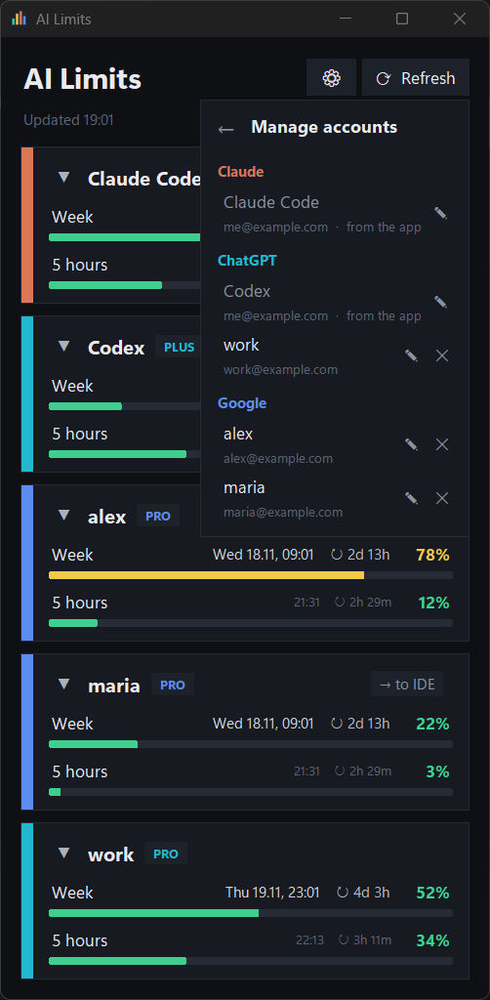
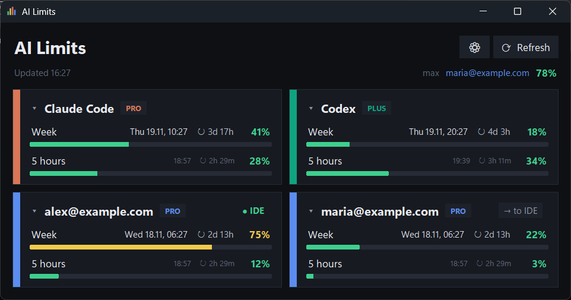
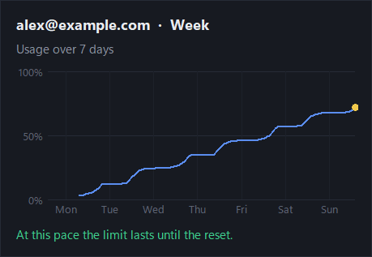
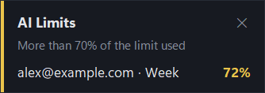

# AI Limits

[English](README.md) | **Русский**

Небольшая программа для Windows 11 для **быстрого переключения между несколькими аккаунтами в один клик** в
**Claude Code** (подписка Claude), **Codex** (подписка ChatGPT) и **Google Antigravity** (модели Gemini) с
одновременным отслеживанием их недельных и 5-часовых лимитов. Аккаунты, под которыми уже вошли ваши программы,
она находит сама и позволяет управлять ими и переключать их из одного компактного окна.

> Неофициальный проект. Не связан с Anthropic, OpenAI и Google. Окно доступно на английском, русском и украинском
> (⚙ → «Язык»; по умолчанию английский); консольная версия — на русском.

<p>
  
  
</p>

## Возможности

**Аккаунты**
- При первом запуске сами появляются все аккаунты, под которыми уже вошли ваши программы: по карточке для
  **Claude Code**, **Codex** и IDE **Antigravity** с названием программы. Карточка всегда показывает аккаунт, под
  которым программа вошла сейчас.
- ⚙ → **«Добавить аккаунт»**: Claude, ChatGPT или Google. Аккаунты Claude и ChatGPT входят через Claude Code
  (`claude auth login`) и Codex (`codex login`) в отдельную папку профиля AI Limits — ваш собственный вход в
  Claude Code и Codex не затрагивается; Google — через браузер (OAuth-ключи автоматически берутся из
  установленной IDE Antigravity). Если нужная программа не установлена (и для Google нет сохранённого ключа),
  появляется всплывающее предупреждение с просьбой установить её. Если новый аккаунт — тот, под которым вошла
  программа, её карточка просто получает его имя.
- У каждого аккаунта своё имя, уникальное в программе (по умолчанию — часть email до «@»; если занято — с
  названием сервиса: «Codex alex»). Переименовать — двойным щелчком по имени в карточке или в
  ⚙ → **«Управление аккаунтами»**: там аккаунты по сервисам, под именем — email, там же удаление; ↻ — войти в добавленный аккаунт заново и обновить вход (принимается только тот же аккаунт).

**Лимиты**
- Недельный и 5-часовой лимиты Claude Code, Codex (подписка ChatGPT) и каждого Google-аккаунта (Gemini), время
  сброса и обратный отсчёт.
- Собственный вход Claude Code и Codex программа только читает (заменяет лишь по кнопкам «→ в Codex» и
  «→ в Claude»); токены профилей, в которые вошла сама AI Limits, хранятся зашифрованными и обновляются ею.
- Лимиты закрытой IDE Antigravity берутся из облака по её же сохранённому входу.
- Самые точные данные берутся прямо из запущенной IDE Antigravity; если она закрыта — из облака.
- Аккаунт с наибольшим остатком недельного лимита (любого сервиса) — справа вверху («макс. … 100%»).
- История расхода (хранится 60 дней): щелчок по строке лимита открывает график расхода и прогноз, на сколько
  хватит лимита при нынешнем темпе.
- Наглядные значки состояния: жёлтый **OFFLINE** (с сохранением последних известных данных в приглушённом виде)
  при отсутствии связи и красный **LOGOUT**, когда Google требует подтвердить аккаунт.

**Аккаунт IDE Antigravity**
- **Кнопка «→ в IDE»**: переводит IDE Antigravity на другой сохранённый аккаунт без страницы входа Google
  (IDE перезапускается; прежние учётные данные сохраняются и возвращаются, если переключение не удалось).
- Работает и при закрытой IDE: запускает IDE (или консольную `agy`, если IDE не установлена) и не меняет аккаунт,
  если IDE и так вошла в нужный.

**Аккаунт Codex**
- **Кнопка «→ в Codex»** у добавленных аккаунтов ChatGPT: Codex начинает работать под этим аккаунтом. Приложение
  Codex закрывается и запускается снова; прежний вход Codex сохраняется копией и остаётся в AI Limits аккаунтом, на
  который можно вернуться (добавляется сам, если его не было). Codex, запущенный в терминале, не закрывается —
  программа попросит закрыть его.

**Аккаунт Claude Code**
- **Кнопка «→ в Claude»** у добавленных аккаунтов Claude: Claude Code начинает работать под этим аккаунтом.
  Меняется только его вход (токен в `~/.claude/.credentials.json` и аккаунт в `~/.claude.json`, остальные настройки
  не трогаются); Claude не закрывается. Новые сеансы Claude Code работают под новым аккаунтом, открытые — под
  прежним до перезапуска; открытый сеанс может даже вернуть прежний вход — тогда повторите смену. Прежний вход
  сохраняется копией и остаётся в AI Limits аккаунтом, на который можно вернуться.

**Окно**
- Карточки сворачиваются (свёрнутая показывает остаток своего недельного лимита), переставляются перетаскиванием
  за цветную полоску слева (остальные плавно сдвигаются) и располагаются в две колонки
  (⚙ → «Карточки в две колонки»).
- Окно запоминает размер и положение; когда карточки или меню настроек ⚙ не помещаются на экране, появляется тонкая полоса прокрутки в стиле программы.
- Автообновление (1 / 5 / 15 минут), режим «поверх всех окон». Карточки и меню ⚙ обновляются на месте, без мигания.
- Иконка в трее с мини-окном при наведении (в том же порядке карточек), тёмное контекстное меню, сворачивание и
  закрытие в трей, автозапуск вместе с Windows. Щелчок по иконке выводит окно на передний план, а если оно уже в
  фокусе — прячет в трей.
- Всплывающее предупреждение над часами, когда лимит пересекает выбранный порог (70–95 % или выключено).
  Всплывающие предупреждения по прогнозу по умолчанию выключены (⚙ → «Предупреждения по прогнозу»).

**Прочее**
- Консольная версия с текстовым выводом и выводом в JSON.
- Версия видна в меню настроек и в свойствах exe; необработанные ошибки пишутся в файл журнала.
- Токены и ключи хранятся зашифрованными (Windows DPAPI).
- Без сторонних пакетов: только стандартная библиотека Python (tkinter и ctypes).

<p>
  
</p>
<p>
  
</p>
<p>
  
  
</p>

## Установка

Готовый `AI.Limits.exe` приложен к каждому [выпуску](https://github.com/Biz2k/AI-Limits/releases) — Python для
его запуска не нужен.

1. Скачайте `AI.Limits.exe` из последнего выпуска, скопируйте его в любую удобную папку и запустите.
   - Файл не подписан, поэтому при первом запуске Windows SmartScreen может показать «Система Windows защитила
     ваш компьютер»: выберите **Подробнее → Выполнить в любом случае**.
   - У каждого выпуска указана сумма SHA-256 файла. Чтобы проверить загрузку, выполните в PowerShell:
     `Get-FileHash "AI.Limits.exe" -Algorithm SHA256`.
2. Аккаунты, под которыми уже вошли ваши программы (**Claude Code**, **Codex**, **Antigravity**), появятся сами.
3. Чтобы добавить дополнительные аккаунты, откройте **⚙ → «Добавить аккаунт»** → Claude, ChatGPT или Google.
   - Ключей в exe нет. При добавлении Google-аккаунта AI Limits сам находит установленную IDE **Antigravity**,
     извлекает её OAuth client id и secret и сохраняет их зашифрованными в `%APPDATA%\ai-limits\keys.dat`. Если
     Antigravity не установлена, используется сохранённый ключ из `keys.dat` (или переменные окружения
     `ANTIGRAVITY_OAUTH_CLIENT_ID` и `ANTIGRAVITY_OAUTH_CLIENT_SECRET`); если нет ни программы, ни ключа —
     показывается всплывающее предупреждение с просьбой установить нужную программу (Antigravity, Claude Code
     или Codex).
   - Карточки Claude Code и Codex (и добавленные аккаунты Claude и ChatGPT) работают и без Google-ключей.

## Консольная версия

```
python limits.py                  показать все лимиты
python limits.py -w 60            обновлять каждые 60 секунд
python limits.py --json           вывод в JSON
python limits.py --version        показать версию
python limits.py add              добавить Google-аккаунт
python limits.py accounts         список сохранённых аккаунтов
python limits.py remove <email>   убрать аккаунт
python limits.py switch-ide <email>    перевести IDE Antigravity на этот аккаунт
python limits.py switch-ide --browser  то же через страницу входа Google
python limits.py restore-ide           вернуть учётные данные IDE из последней резервной копии
python limits.py keys                  ввести id и secret OAuth-клиента Antigravity
```

Аккаунты Claude и ChatGPT, добавленные в окне, консольная версия тоже показывает (`--json`: `profiles`).

## Запуск из исходников и сборка exe

**Что нужно:**
- Windows 11
- Python 3.13 (подходит сборка из Microsoft Store)
- Claude Code (`~/.claude/.credentials.json`) — по желанию, для карточки Claude, добавления и переключения аккаунтов Claude
- Codex (`~/.codex/auth.json`) — по желанию, для карточки Codex, добавления и переключения аккаунтов ChatGPT
- IDE Antigravity — по желанию, для данных из IDE, переключения аккаунта и автопоиска Google OAuth-ключей
- PyInstaller 6.x — только для сборки exe

**Запуск из исходников:**

```
pythonw limits_gui.pyw
```

OAuth-ключей Antigravity **нет** ни в репозитории, ни в exe: при добавлении Google-аккаунта программа
автоматически берёт их из установленной IDE Antigravity и сохраняет зашифрованными в
`%APPDATA%\ai-limits\keys.dat`. Если Antigravity не установлена, их можно задать вручную командой
`python limits.py keys`, через переменные окружения `ANTIGRAVITY_OAUTH_CLIENT_ID` и
`ANTIGRAVITY_OAUTH_CLIENT_SECRET` либо скопировав `local_keys.example.py` в `local_keys.py` (те же значения
клиента есть в открытом npm-пакете [`antigravity-usage`](https://www.npmjs.com/package/antigravity-usage)).

**Сборка exe:**

```
python -m pip install --user pyinstaller
build_exe.cmd
```

Скрипт сначала запускает проверки из `tests\` (на вымышленных данных; окно программы откроется на несколько
секунд), затем собирает один оконный `AI Limits.exe` и кладёт его в родительскую папку, а рядом — его сумму
SHA-256 в файле `AI Limits.exe.sha256`. В exe нет ни ключей, ни токенов.

Только проверки: `python tests\run_tests.py`.

## Где хранятся данные

Всё лежит в `%APPDATA%\ai-limits\`:

| Файл | Что в нём |
| --- | --- |
| `accounts.json` | refresh-токены Google добавленных аккаунтов (зашифрованы) |
| `profiles.json`, `profiles\` | добавленные аккаунты Claude и ChatGPT: по папке на аккаунт, вход — в `creds.dat` (зашифрован) |
| `keys.dat` | OAuth-ключи (client id и secret Antigravity, заполняются автоматически из установленной IDE; зашифрованы) |
| `cache.json` | последние увиденные значения лимитов (до сброса каждого лимита) |
| `gui.json` | настройки окна, имена аккаунтов |
| `history.csv` | значения лимитов во времени, хранятся 60 дней (токенов нет) |
| `ide_backups\` | копии учётных данных IDE перед каждой сменой аккаунта (последние 5, зашифрованы) |
| `ide_switch.log` | журнал смены аккаунта (токены скрыты) |
| `codex_backups\` | копии входа Codex перед каждым «→ в Codex» (последние 5, зашифрованы) |
| `claude_backups\` | копии входа Claude Code перед каждым «→ в Claude» (последние 5, зашифрованы) |
| `app.log` | необработанные ошибки с версией программы (строки, похожие на токены, скрыты) |

Токены, ключи и копии учётных данных зашифрованы средствами Windows (DPAPI): расшифровать их может только ваша
учётная запись Windows на этом компьютере, поэтому на другом компьютере или у другого пользователя папка
бесполезна (аккаунты и ключи там нужно добавить заново). Программы, запущенные под вашей учётной записью,
расшифровать их по-прежнему могут.

## Как работает смена аккаунта IDE

По кнопке «→ в IDE» программа получает свежий токен доступа выбранного аккаунта, сохраняет текущие учётные данные
IDE, закрывает IDE, записывает токен в запись IDE в диспетчере учётных данных Windows (`gemini:antigravity`) и в
два файла в `%APPDATA%\Antigravity\`, снова запускает IDE и через её локальный сервер проверяет, что вошёл нужный
аккаунт. Если IDE показывает другой аккаунт или не вошла ни в какой, возвращается сохранённая копия.

Если IDE закрыта, а сохранённый в ней вход уже принадлежит выбранному аккаунту, программа просто запускает IDE.
Если IDE не установлена, вместо неё запускается консольная `agy` (она пользуется той же записью диспетчера
учётных данных); проверить аккаунт через сервер IDE в этом случае негде.

Это не официальный механизм. Он может перестать работать после обновления IDE; пользуйтесь им на свой риск.

## Оговорки

- Программа опирается на недокументированные адреса Anthropic, OpenAI и Google и на OAuth-клиенты Claude Code,
  Codex и Antigravity (дополнительные аккаунты Claude и ChatGPT входят через сами Claude Code и Codex). Они могут
  измениться или быть закрыты в любой момент, а их использование может противоречить условиям этих сервисов.
- Чтобы получать оба лимита Gemini для аккаунтов, не вошедших в IDE, программа в запросах к Google называет себя
  свежей версией IDE Antigravity.
- Программа читает и изменяет учётные данные IDE Antigravity, Codex и Claude Code на вашем компьютере (при
  переключении аккаунтов, с автоматическим резервным копированием перед изменением).
- Никаких гарантий; см. лицензию.

## Лицензия

[MIT](LICENSE)
