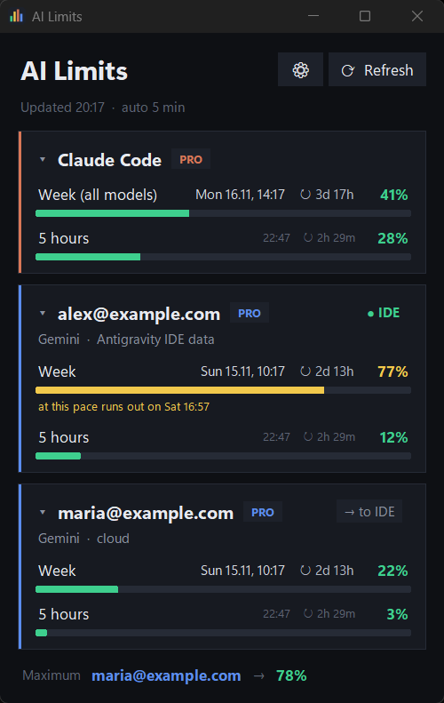
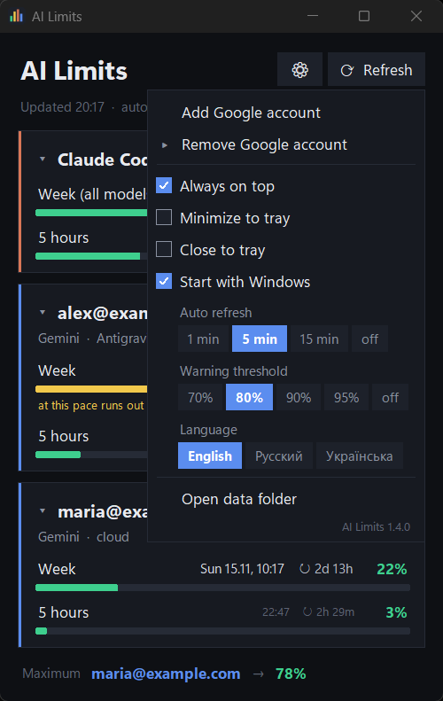
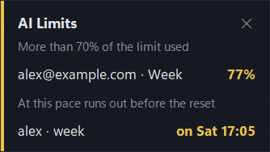

# AI Limits

[English](README.md) | **Русский**

Небольшая программа для Windows 11, которая показывает, сколько израсходовано лимитов **Claude Code**
(подписка Pro) и **Google Antigravity** (модели Gemini) — сразу для нескольких Google-аккаунтов.
Ещё она одним нажатием переключает аккаунт, под которым работает IDE Antigravity.

> Неофициальный проект. Не связан с Anthropic и Google. Окно доступно на английском, русском и украинском
> (⚙ → «Язык»; по умолчанию английский); консольная версия — на русском.

<p>
  
  
</p>

## Возможности

- Недельный и 5-часовой лимиты Claude Code и каждого Google-аккаунта, время сброса и обратный отсчёт.
- Самые точные данные берутся прямо из запущенной IDE Antigravity; если она закрыта — из облака.
- **Кнопка «→ в IDE»**: переводит IDE Antigravity на другой сохранённый аккаунт без страницы входа Google
  (IDE перезапускается; прежние учётные данные сохраняются и возвращаются, если переключение не удалось).
- Иконка в трее с мини-окном при наведении, тёмное контекстное меню, сворачивание и закрытие в трей,
  автозапуск вместе с Windows.
- Всплывающее предупреждение над часами, когда лимит пересекает выбранный порог (70–95 % или выключено).
- История расхода (хранится 60 дней) и прогноз: если лимит закончится раньше своего сброса, карточка и окно
  у трея показывают, на сколько его хватит; щелчок по строке лимита открывает график расхода. Всплывающие
  предупреждения по прогнозу по умолчанию выключены (⚙ → «Предупреждения по прогнозу»).
- Автообновление (1 / 5 / 15 минут), режим «поверх всех окон», сворачиваемые карточки. Карточки обновляются на
  месте, без мигания.
- Консольная версия с текстовым выводом и выводом в JSON.
- Версия видна в меню настроек и в свойствах exe; необработанные ошибки пишутся в файл журнала.
- Токены и ключи хранятся зашифрованными (Windows DPAPI).
- Без сторонних пакетов: только стандартная библиотека Python (tkinter и ctypes).



## Загрузка

Готовый `AI Limits.exe` приложен к каждому [выпуску](https://github.com/Biz2k/AI-Limits/releases); Python для
его запуска не нужен.

- Файл не подписан, поэтому при первом запуске Windows SmartScreen может показать «Система Windows защитила ваш
  компьютер»: выберите **Подробнее → Выполнить в любом случае**.
- У каждого выпуска указана сумма SHA-256 файла. Чтобы проверить загрузку, выполните в PowerShell
  `Get-FileHash "AI Limits.exe" -Algorithm SHA256` и сравните результат.
- Ключей в exe нет. Перед добавлением Google-аккаунта задайте id и secret OAuth-клиента приложения Antigravity
  (откуда их взять — в разделе [Установка](#установка)) переменными окружения и запустите программу заново:

  ```
  setx ANTIGRAVITY_OAUTH_CLIENT_ID "<client id>"
  setx ANTIGRAVITY_OAUTH_CLIENT_SECRET "<client secret>"
  ```

  Карточка Claude Code работает и без них.

## Что нужно

Для запуска из исходников:


- Windows 11
- Python 3.13 (подходит сборка из Microsoft Store)
- Установленный Claude Code с выполненным входом (`~/.claude/.credentials.json`) — для карточки Claude
- IDE Antigravity — по желанию, нужна для данных из IDE и для переключения аккаунта
- PyInstaller 6.x — только для сборки exe

## Установка

1. Склонируйте репозиторий.
2. Запустите окно:

   ```
   pythonw limits_gui.pyw
   ```

3. Введите id и secret OAuth-клиента приложения Antigravity командой `python limits.py keys`
   (окно перед этим закройте, после — запустите снова). Ни в репозитории, ни в exe их **нет**. Это те значения, с которыми выполняет
   вход само приложение Antigravity; они есть в исходном коде открытого npm-пакета
   [`antigravity-usage`](https://www.npmjs.com/package/antigravity-usage) — оттуда их взял и этот проект.
   Программа хранит их в
   `%APPDATA%\ai-limits\keys.dat` зашифрованными под вашей учётной записью Windows. Вместо этого можно задать
   переменные окружения `ANTIGRAVITY_OAUTH_CLIENT_ID` и `ANTIGRAVITY_OAUTH_CLIENT_SECRET` либо, при запуске из
   исходников, скопировать `local_keys.example.py` в `local_keys.py` и заполнить его.
4. Добавьте Google-аккаунт: ⚙ → «Добавить Google-аккаунт» (в браузере откроется страница входа Google).

## Консольная версия

```
python limits.py                  показать все лимиты
python limits.py -w 60            обновлять каждые 60 секунд
python limits.py --json           вывод в JSON
python limits.py --version        показать версию
python limits.py add              добавить Google-аккаунт
python limits.py accounts         список сохранённых аккаунтов
python limits.py remove <email>   убрать аккаунт
python limits.py switch-ide <email>    перевести IDE Antigravity на этот аккаунт
python limits.py switch-ide --browser  то же через страницу входа Google
python limits.py restore-ide           вернуть учётные данные IDE из последней резервной копии
python limits.py keys                  ввести id и secret OAuth-клиента Antigravity
```

## Сборка exe

```
python -m pip install --user pyinstaller
build_exe.cmd
```

Скрипт сначала запускает проверки из `tests\` (на вымышленных данных; окно программы откроется на несколько
секунд), затем собирает один оконный `AI Limits.exe` и кладёт его в родительскую папку, а рядом — его сумму
SHA-256 в файле `AI Limits.exe.sha256`. В exe нет ни ключей, ни токенов.

Только проверки: `python tests\run_tests.py`.

## Где хранятся данные

Всё лежит в `%APPDATA%\ai-limits\`:

| Файл | Что в нём |
| --- | --- |
| `accounts.json` | refresh-токены Google добавленных аккаунтов (зашифрованы) |
| `keys.dat` | id и secret OAuth-клиента Antigravity (зашифрованы) |
| `cache.json` | последние увиденные значения лимитов (до сброса каждого лимита) |
| `gui.json` | настройки окна |
| `history.csv` | значения лимитов во времени, хранятся 60 дней (токенов нет) |
| `ide_backups\` | копии учётных данных IDE перед каждой сменой аккаунта (последние 5, зашифрованы) |
| `ide_switch.log` | журнал смены аккаунта (токены скрыты) |
| `app.log` | необработанные ошибки с версией программы (строки, похожие на токены, скрыты) |

Токены, ключи и копии учётных данных зашифрованы средствами Windows (DPAPI): расшифровать их может только ваша
учётная запись Windows на этом компьютере, поэтому на другом компьютере или у другого пользователя папка
бесполезна (аккаунты и ключи там нужно добавить заново). Программы, запущенные под вашей учётной записью,
расшифровать их по-прежнему могут.

## Как работает смена аккаунта IDE

По кнопке «→ в IDE» программа получает свежий токен доступа выбранного аккаунта, сохраняет текущие учётные данные
IDE, закрывает IDE, записывает токен в запись IDE в диспетчере учётных данных Windows (`gemini:antigravity`) и в
два файла в `%APPDATA%\Antigravity\`, снова запускает IDE и через её локальный сервер проверяет, что вошёл нужный
аккаунт. Если IDE показывает другой аккаунт или не вошла ни в какой, возвращается сохранённая копия.

Это не официальный механизм. Он может перестать работать после обновления IDE; пользуйтесь им на свой риск.

## Оговорки

- Программа опирается на недокументированные адреса Anthropic и Google и на OAuth-клиенты Claude Code и
  Antigravity. Они могут измениться или быть закрыты в любой момент, а их использование может противоречить
  условиям этих сервисов.
- Чтобы получать оба лимита Gemini для аккаунтов, не вошедших в IDE, программа в запросах к Google называет себя
  свежей версией IDE Antigravity.
- Программа читает и изменяет учётные данные IDE Antigravity на вашем компьютере.
- Никаких гарантий; см. лицензию.

## Лицензия

[MIT](LICENSE)
