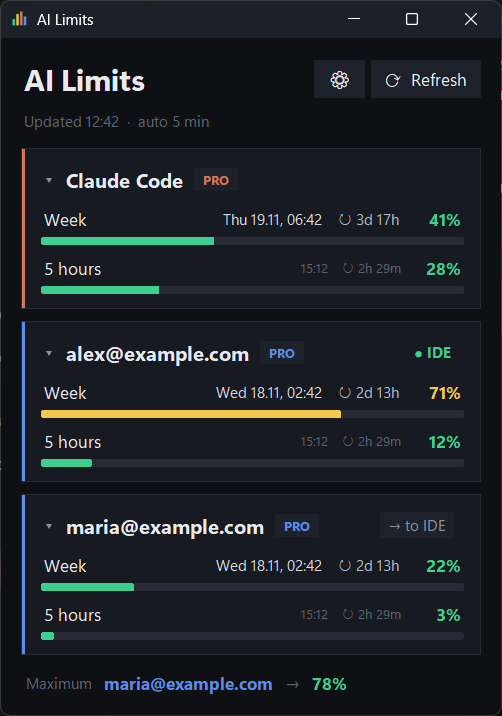
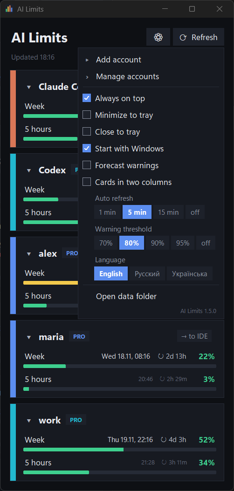
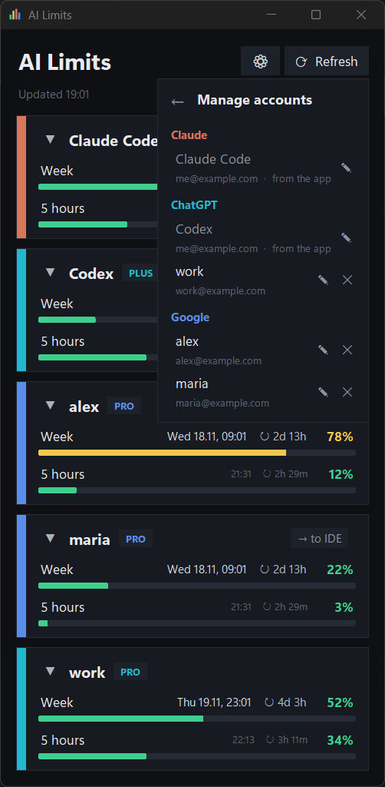
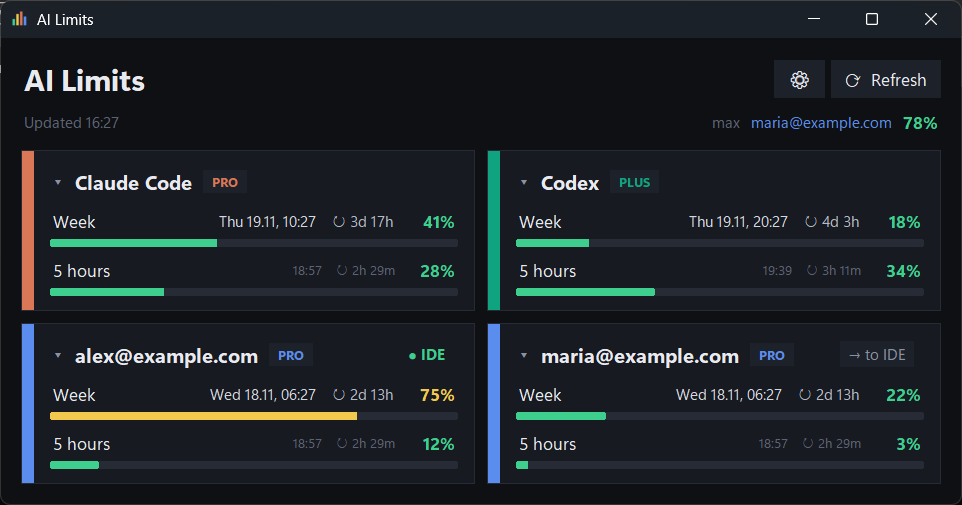
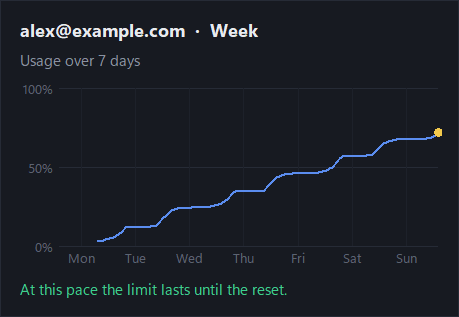
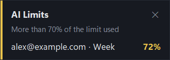

# AI Limits

🌐 [🇬🇧 English](README.md) | [🇷🇺 Русский](README.ru.md) | **🇺🇦 Українська**

[](https://github.com/Biz2k/AI-Limits/releases/tag/v1.6.1)
[](LICENSE)
[](https://github.com/Biz2k/AI-Limits)
[](https://www.python.org)
[](src/limits_gui.pyw)

Невелика програма для Windows 11 для **швидкого перемикання між кількома акаунтами в один клік** у
**Claude Code** (підписка Claude), **Codex** (підписка ChatGPT) та **Google Antigravity** (моделі Gemini) з
одночасним відстеженням їхніх тижневих і 5-годинних лімітів. Акаунти, під якими вже увійшли ваші програми,
вона знаходить сама і дозволяє керувати ними та перемикати їх з одного компактного вікна.

> Неофіційний проєкт. Не пов'язаний з Anthropic, OpenAI та Google. Вікно доступне англійською, російською та
> українською (⚙ → «Мова»; за замовчуванням англійська); консольна версія — російською.

<p>
  
  
</p>

---

## ✨ Можливості

**Акаунти**
- При першому запуску самі з'являються всі акаунти, під якими вже увійшли ваші програми: по картці для
  **Claude Code**, **Codex** та **Antigravity** із назвою програми. Картка завжди показує акаунт, під
  яким програма увійшла зараз.
- ⚙ → **«Додати акаунт»**: Claude, ChatGPT або Google. Акаунти Claude і ChatGPT входять через Claude Code
  (`claude auth login`) і Codex (`codex login`) в окрему папку профілю AI Limits — ваш власний вхід у
  Claude Code і Codex не зачіпається; Google — через браузер (OAuth-ключі автоматично беруться зі
  встановленої Antigravity). Якщо потрібна програма не встановлена (і для Google немає збереженого ключа),
  з'являється спливаюче попередження з проханням установити її. Якщо новий акаунт — той, під яким увійшла
  програма, її картка просто отримує його ім'я.
- У кожного акаунта своє ім'я, унікальне в програмі (за замовчуванням — частина email до «@»; якщо зайняте — з
  назвою сервісу: «Codex alex»). Перейменувати — подвійним кліком по імені в картці або в
  ⚙ → **«Керування акаунтами»**: там акаунти за сервісами, під ім'ям — email, там же видалення; ↻ — увійти в
  доданий акаунт заново та оновити вхід (приймається лише той самий акаунт).

**Ліміти**
- Тижневий і 5-годинний ліміти Claude Code, Codex (підписка ChatGPT) і кожного Google-акаунта (Gemini), час
  скидання та зворотний відлік.
- Власний вхід Claude Code і Codex програма лише читає (замінює тільки за кнопками «→ в Codex» і
  «→ в Claude»); токени профілів, у які увійшла сама AI Limits, зберігаються зашифрованими й оновлюються нею.
- Ліміти закритої Antigravity беруться з хмари за її власним збереженим входом.
- Найточніші дані беруться прямо із запущеної Antigravity; якщо вона закрита — з хмари.
- Акаунт із найбільшим залишком тижневого ліміту (будь-якого сервісу) — справа вгорі («макс. … 100%»).
- Історія витрат (зберігається 60 днів): клік по рядку ліміту відкриває графік витрат і прогноз, на скільки
  вистачить ліміту за поточного темпу.
- Наочні значки стану: жовтий **OFFLINE** (зі збереженням останніх відомих даних у приглушеному вигляді)
  за відсутності зв'язку та червоний **LOGOUT**, коли Google вимагає підтвердити акаунт.

**Акаунт Antigravity**
- **Кнопка «→ в Antigravity»**: переводить Antigravity на інший збережений акаунт без сторінки входу Google
  (Antigravity перезапускається; попередні облікові дані зберігаються та повертаються, якщо перемикання не вдалося).
- Працює і при закритій Antigravity: запускає Antigravity (або консольну `agy`, якщо Antigravity не встановлена)
  і не змінює акаунт, якщо Antigravity і так увійшла в потрібний.

**Акаунт Codex**
- **Кнопка «→ в Codex»** у доданих акаунтів ChatGPT: Codex починає працювати під цим акаунтом. Застосунок
  Codex закривається і запускається знову; попередній вхід Codex зберігається копією та залишається в AI Limits
  акаунтом, на який можна повернутися (додається сам, якщо його не було). Codex, запущений у терміналі, не
  закривається — програма попросить закрити його.

**Акаунт Claude Code**
- **Кнопка «→ в Claude»** у доданих акаунтів Claude: Claude Code починає працювати під цим акаунтом.
  Змінюється лише його вхід (токен у `~/.claude/.credentials.json` та акаунт у `~/.claude.json`, інші налаштування
  не зачіпаються); Claude не закривається. Нові сеанси Claude Code працюють під новим акаунтом, відкриті — під
  попереднім до перезапуску; відкритий сеанс може навіть повернути попередній вхід — тоді повторіть зміну.
  Попередній вхід зберігається копією та залишається в AI Limits акаунтом, на який можна повернутися.

**Вікно**
- Картки згортаються (згорнута показує залишок свого тижневого ліміту), переставляються перетягуванням
  за кольорову смужку зліва (інші плавно зсуваються) та розташовуються у дві колонки
  (⚙ → «Картки у дві колонки»).
- Вікно запам'ятовує розмір і положення; коли картки або меню налаштувань ⚙ не вміщуються на екрані, з'являється
  тонка смуга прокрутки в стилі програми.
- Автооновлення (1 / 5 / 15 хвилин), режим «поверх усіх вікон». Картки та меню ⚙ оновлюються на місці, без мерехтіння.
- Іконка в треї з міні-вікном при наведенні (у тому ж порядку карток), темне контекстне меню, згортання та
  закриття в трей, автозапуск разом із Windows. Клік по іконці виводить вікно на передній план, а якщо воно вже у
  фокусі — ховає в трей.
- Спливаюче попередження над годинником, коли ліміт перетинає вибраний поріг (70–95 % або вимкнено).
  Спливаючі попередження за прогнозом за замовчуванням вимкнені (⚙ → «Попередження за прогнозом»).

**Інше**
- Консольна версія з текстовим виводом і виводом у JSON.
- Версія видна в меню налаштувань і у властивостях exe; програма раз на добу (або через ⚙ → «Перевірити оновлення»)
  перевіряє GitHub Releases, показує значок оновлення в шапці вікна та вміє сама завантажити, перевірити SHA-256
  і оновити exe. Необроблені помилки пишуться у файл журналу.
- Токени та ключі зберігаються зашифрованими (Windows DPAPI).
- Без сторонніх пакетів: лише стандартна бібліотека Python (tkinter і ctypes).

<p>
  
</p>
<p>
  
</p>
<p>
  
  
</p>

---

## ⚡ Встановлення

Готовий `AI.Limits.exe` прикріплений до кожного [випуску](https://github.com/Biz2k/AI-Limits/releases) — Python для
його запуску не потрібен.

1. Завантажте `AI.Limits.exe` з останнього випуску, скопіюйте його в будь-яку зручну папку та запустіть.
   - Файл не підписаний, тому при першому запуску Windows SmartScreen може показати «Система Windows захистила
     ваш комп'ютер»: виберіть **Докладніше → Усе одно виконати**.
   - У кожного випуску вказана сума SHA-256 файлу. Щоб перевірити завантаження, виконайте в PowerShell:
     `Get-FileHash "AI.Limits.exe" -Algorithm SHA256`.
2. Акаунти, під якими вже увійшли ваші програми (**Claude Code**, **Codex**, **Antigravity**), з'являться самі.
3. Щоб додати додаткові акаунти, відкрийте **⚙ → «Додати акаунт»** → Claude, ChatGPT або Google.
   - Ключів в exe немає. При додаванні Google-акаунта AI Limits сам знаходить встановлену **Antigravity**,
     витягує її OAuth client id та secret і зберігає їх зашифрованими в `%APPDATA%\ai-limits\keys.dat`. Якщо
     Antigravity не встановлена, використовується збережений ключ із `keys.dat` (або змінні середовища
     `ANTIGRAVITY_OAUTH_CLIENT_ID` і `ANTIGRAVITY_OAUTH_CLIENT_SECRET`); якщо немає ні програми, ні ключа —
     показується спливаюче попередження з проханням установити потрібну програму (Antigravity, Claude Code
     або Codex).
   - Картки Claude Code і Codex (та додані акаунти Claude і ChatGPT) працюють і без Google-ключів.

---

## 💻 Консольна версія

```
python src\limits.py                  показати всі ліміти
python src\limits.py -w 60            оновлювати кожні 60 секунд
python src\limits.py --json           вивід у JSON
python src\limits.py --version        показати версію
python src\limits.py add              додати Google-акаунт
python src\limits.py accounts         список збережених акаунтів
python src\limits.py remove <email>   видалити акаунт
python src\limits.py switch-ide <email>    перевести Antigravity на цей акаунт
python src\limits.py switch-ide --browser  те саме через сторінку входу Google
python src\limits.py restore-ide           повернути облікові дані Antigravity з останньої резервної копії
python src\limits.py keys                  ввести id і secret OAuth-клієнта Antigravity
```

Акаунти Claude і ChatGPT, додані у вікні, консольна версія також показує (`--json`: `profiles`).

---

## 🛠️ Запуск із вихідного коду та збірка exe

**Що потрібно:**
- Windows 11
- Python 3.13 (підходить збірка з Microsoft Store)
- Claude Code (`~/.claude/.credentials.json`) — за бажанням, для картки Claude, додавання та перемикання акаунтів Claude
- Codex (`~/.codex/auth.json`) — за бажанням, для картки Codex, додавання та перемикання акаунтів ChatGPT
- Antigravity — за бажанням, для даних з Antigravity, перемикання акаунта та автопошуку Google OAuth-ключів
- PyInstaller 6.x — лише для збірки exe

**Запуск із вихідного коду:**

```
pythonw src\limits_gui.pyw
```

OAuth-ключів Antigravity **немає** ні в репозиторії, ні в exe: при додаванні Google-акаунта програма
автоматично бере їх зі встановленої Antigravity та зберігає зашифрованими в
`%APPDATA%\ai-limits\keys.dat`. Якщо Antigravity не встановлена, їх можна задати вручну командою
`python src\limits.py keys`, через змінні середовища `ANTIGRAVITY_OAUTH_CLIENT_ID` і
`ANTIGRAVITY_OAUTH_CLIENT_SECRET` або скопіювавши `src\local_keys.example.py` в `src\local_keys.py` (ті самі
значення клієнта є у відкритому npm-пакеті [`antigravity-usage`](https://www.npmjs.com/package/antigravity-usage)).

**Збірка exe:**

```
python -m pip install --user pyinstaller
src\build_exe.cmd
```

Скрипт спочатку запускає перевірки з `tests\` (на вигаданих даних; вікно програми відкриється на кілька
секунд), потім збирає один віконний `AI Limits.exe` і кладе його в батьківську папку, а поруч — його суму
SHA-256 у файлі `AI Limits.exe.sha256`. В exe немає ні ключів, ні токенів.

Лише перевірки: `python tests\run_tests.py`.

---

## 📁 Де зберігаються дані

Усе лежить у `%APPDATA%\ai-limits\`:

| Файл | Що в ньому |
| --- | --- |
| `accounts.json` | refresh-токени Google доданих акаунтів (зашифровані) |
| `profiles.json`, `profiles\` | додані акаунти Claude і ChatGPT: по папці на акаунт, вхід — у `creds.dat` (зашифрований) |
| `keys.dat` | OAuth-ключі (client id і secret Antigravity, заповнюються автоматично зі встановленої Antigravity; зашифровані) |
| `cache.json` | останні побачені значення лімітів (до скидання кожного ліміту) |
| `gui.json` | налаштування вікна, імена акаунтів |
| `history.csv` | значення лімітів у часі, зберігаються 60 днів (токенів немає) |
| `ide_backups\` | копії облікових даних Antigravity перед кожною зміною акаунта (останні 5, зашифровані) |
| `ide_switch.log` | журнал зміни акаунта (токени приховані) |
| `codex_backups\` | копії входу Codex перед кожним «→ в Codex» (останні 5, зашифровані) |
| `claude_backups\` | копії входу Claude Code перед кожним «→ в Claude» (останні 5, зашифровані) |
| `app.log` | необроблені помилки з версією програми (рядки, схожі на токени, приховані) |

Токени, ключі та копії облікових даних зашифровані засобами Windows (DPAPI): розшифрувати їх може лише ваш
обліковий запис Windows на цьому комп'ютері, тому на іншому комп'ютері або в іншого користувача папка
марна (акаунти та ключі там потрібно додати заново). Програми, запущені під вашим обліковим записом,
розшифрувати їх, як і раніше, можуть.

---

## 🔄 Як працює зміна акаунта Antigravity

За кнопкою «→ в Antigravity» програма отримує свіжий токен доступу вибраного акаунта, зберігає поточні облікові дані
Antigravity, закриває Antigravity, записує токен у запис Antigravity у диспетчері облікових даних Windows (`gemini:antigravity`)
та у два файли в `%APPDATA%\Antigravity\`, знову запускає Antigravity і через її локальний сервер перевіряє, що увійшов
потрібний акаунт. Якщо Antigravity показує інший акаунт або не увійшла в жодний, повертається збережена копія.

Якщо Antigravity закрита, а збережений у ній вхід уже належить вибраному акаунту, програма просто запускає Antigravity.
Якщо Antigravity не встановлена, замість неї запускається консольна `agy` (вона користується тим самим записом
диспетчера облікових даних); перевірити акаунт через сервер Antigravity в цьому випадку немає де.

Це не офіційний механізм. Він може перестати працювати після оновлення Antigravity; користуйтеся ним на власний ризик.

---

## ⚠️ Застереження

- Програма спирається на недокументовані адреси Anthropic, OpenAI та Google і на OAuth-клієнти Claude Code,
  Codex та Antigravity (додаткові акаунти Claude і ChatGPT входять через самі Claude Code і Codex). Вони можуть
  змінитися або бути закриті будь-якої миті, а їх використання може суперечити умовам цих сервісів.
- Щоб отримувати обидва ліміти Gemini для акаунтів, що не увійшли в Antigravity, програма в запитах до Google
  називає себе свіжою версією Antigravity.
- Програма читає та змінює облікові дані Antigravity, Codex і Claude Code на вашому комп'ютері (під час
  перемикання акаунтів, з автоматичним резервним копіюванням перед зміною).
- Жодних гарантій; див. ліцензію.

---

## 📄 Ліцензія

[MIT](LICENSE)
